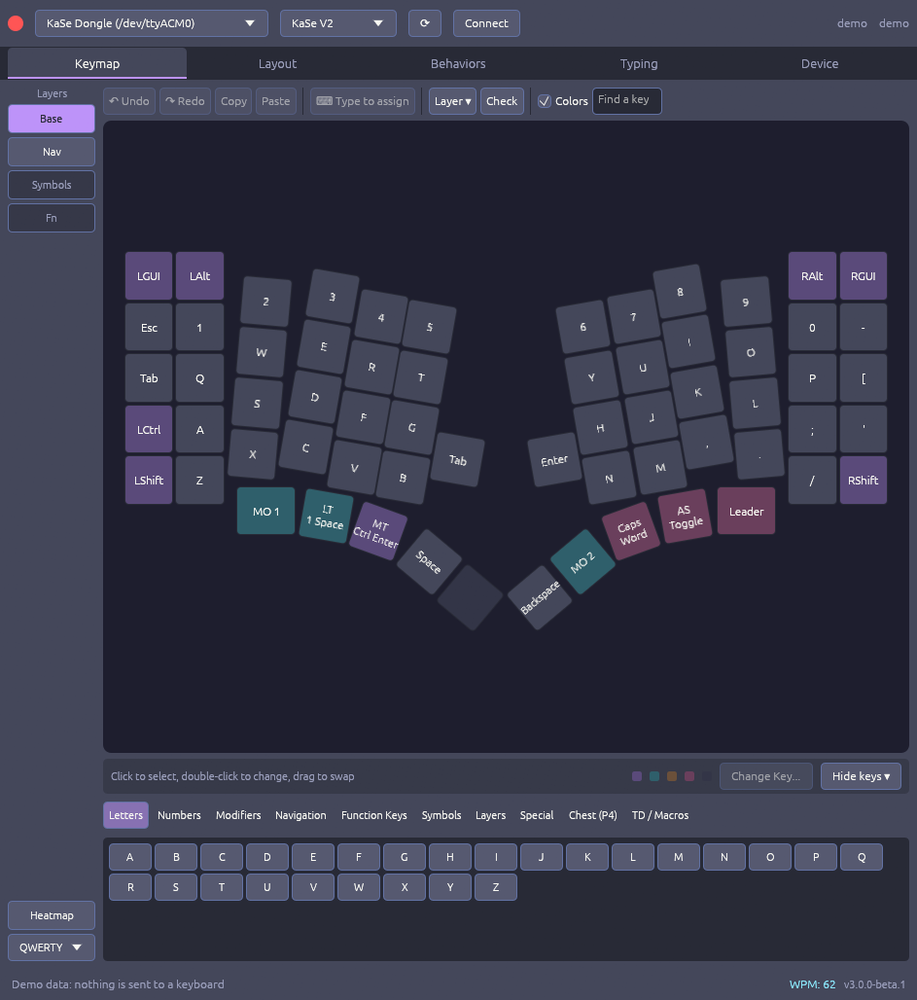
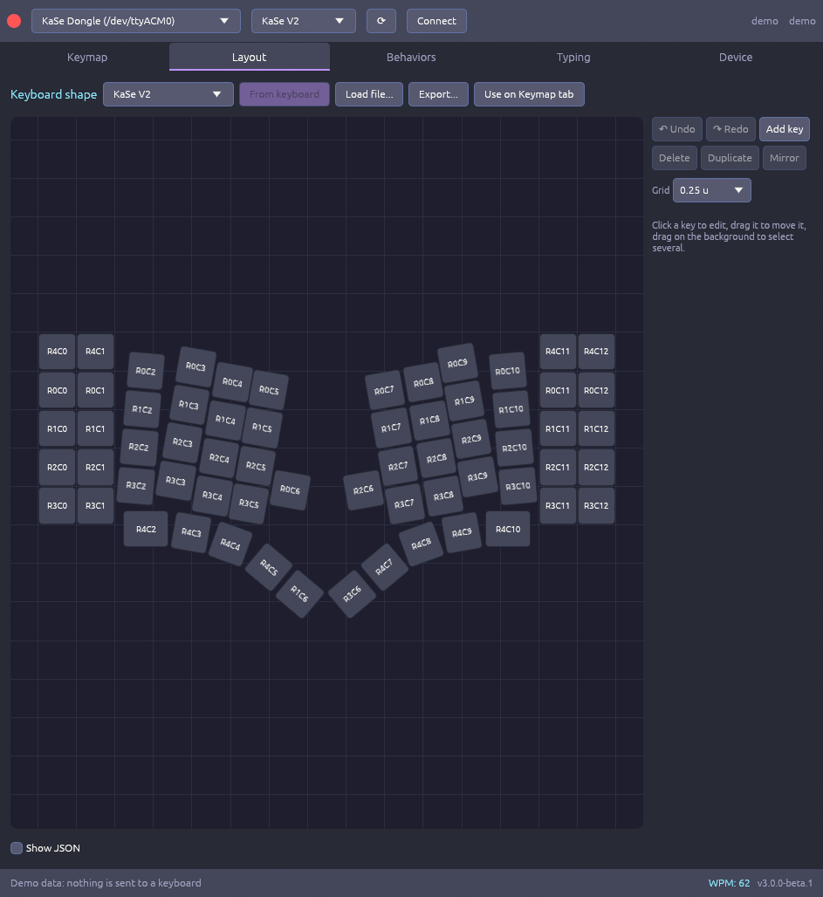
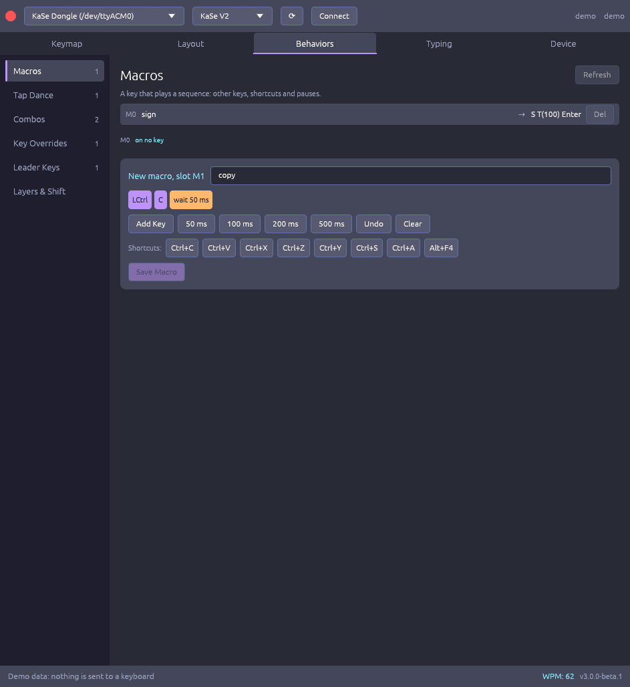
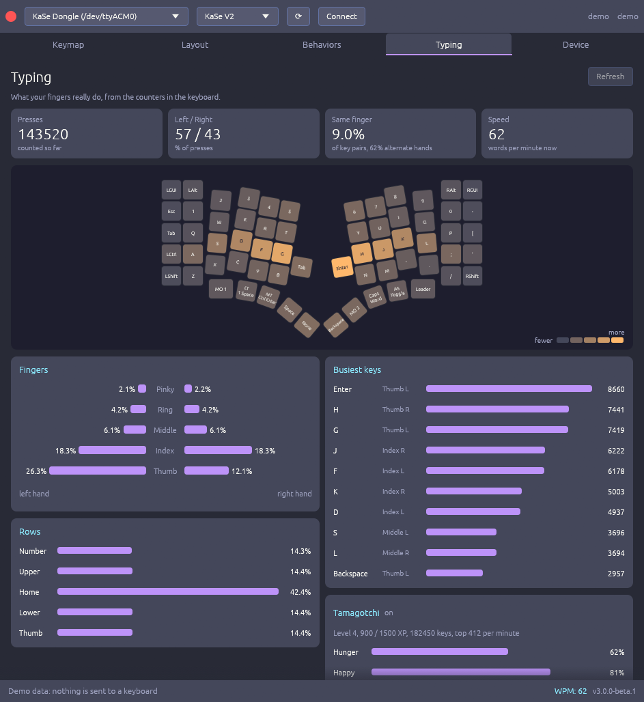
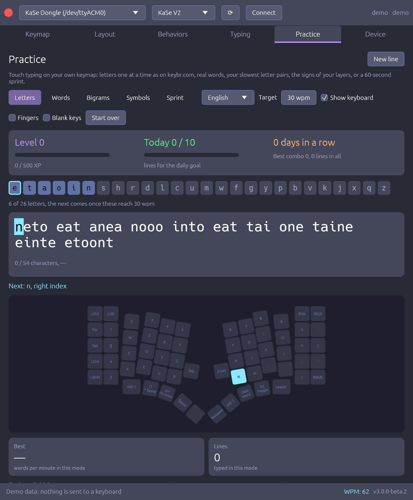

# KeSp Controller

Configurator for the KeSp / KaSe split ergonomic keyboards, on the desktop and in the browser.

Built with [Rust](https://www.rust-lang.org/) and [egui](https://github.com/emilk/egui).


**[Open it in your browser](https://mornepousse.github.io/KeSp_controller/)** (Chrome or Edge), or [download it](#download).



> **Version 3 is in beta.** It replaces the Slint interface of version 2. See [what has been tried on a real keyboard](#status-of-the-beta) before you rely on it.

## What it does

| | |
|---|---|
|  |  |
|  |  |

- **Keymap**: click a key to select it, double-click to change it, drag to swap two keys. Undo and redo, copy and paste, type to assign, find a key, heatmap, and labels for QWERTY, AZERTY, QWERTZ, Dvorak, Colemak and more.
- **Check**: finds what is wrong in a keymap, such as a key that does nothing or a layer no key reaches, and takes you to it.
- **Layout**: draw the shape of a keyboard. Drag, duplicate, mirror and snap keys to a grid, or start from the models that come with the firmware. Import and export as JSON.
- **Behaviors**: macros, tap dance, combos, key overrides, leader keys and layer settings. Macros and tap dances show which keys use them.
- **Practice**: learn touch typing on your own keymap. Letters come in one at a time, the most frequent first, as on keybr.com; the next key, its finger and the layer key to hold light up on your keyboard. Stars, levels, combos, a daily goal, streaks and badges keep it a game.
- **Typing**: hand balance, finger load, row usage, busiest keys, same-finger pairs and speed, from the counters in the keyboard.
- **Device**: status, radio link and battery of each half through the dongle, pairing, backup and restore, OTA update, ESP32 flasher, matrix test and reset.
- **Demo mode**: try everything without a keyboard with `--demo`. Nothing is sent anywhere.

## Download

Binaries for Linux and Windows are on the [GitHub releases](https://github.com/mornepousse/KeSp_controller/releases) and [GitLab releases](https://gitlab.com/harrael/KeSp_controller/-/releases) pages.

## In the browser

The [web version](https://mornepousse.github.io/KeSp_controller/) talks to the keyboard over Web Serial, which only Chrome and Edge offer. Firmware updates need the desktop app: a failed update in a browser tab could leave a keyboard unusable.

## Usage

1. Plug in the keyboard or its dongle over USB.
2. Start KeSp Controller. The desktop app connects by itself. In the browser, press **Connect** and choose the port.
3. Use the tabs: Keymap, Layout, Behaviors, Typing, Practice, Device.

## Build from source

You need a recent stable Rust toolchain. On Linux, also `libudev-dev`.

```bash
cargo build --release
```

The binary is `target/release/KeSp_controller`.

For the web version, add the `wasm32-unknown-unknown` target, then:

```bash
tools/build_web.sh   # builds into web/
tools/serve_web.sh   # serves it on localhost
```

Each `v*` tag publishes the web version to GitHub Pages.

## Keyboard compatibility

Keyboards running the KaSe firmware with the binary protocol v2 over USB CDC serial, directly or through the dongle. Models included: KaSe V1, KaSe V2, Niphargus and Niphargus Right.

## Status of the beta

Tried on a real Niphargus through the dongle: connecting, reading every tab, changing a key.

Not yet tried on a real keyboard: saving macros, combos, tap dances, overrides and leader keys, restoring a backup, OTA update, flashing, pairing, matrix test, resets, and Web Serial.

**Back up your configuration first**, and keep version 2.2.0 around for firmware updates until this list is empty. Please report what you find in the [issues](https://gitlab.com/harrael/KeSp_controller/-/issues).

## License

GPL-3.0. See [LICENSE](LICENSE).
